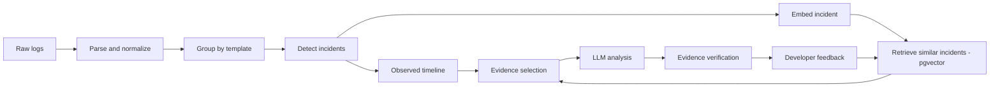
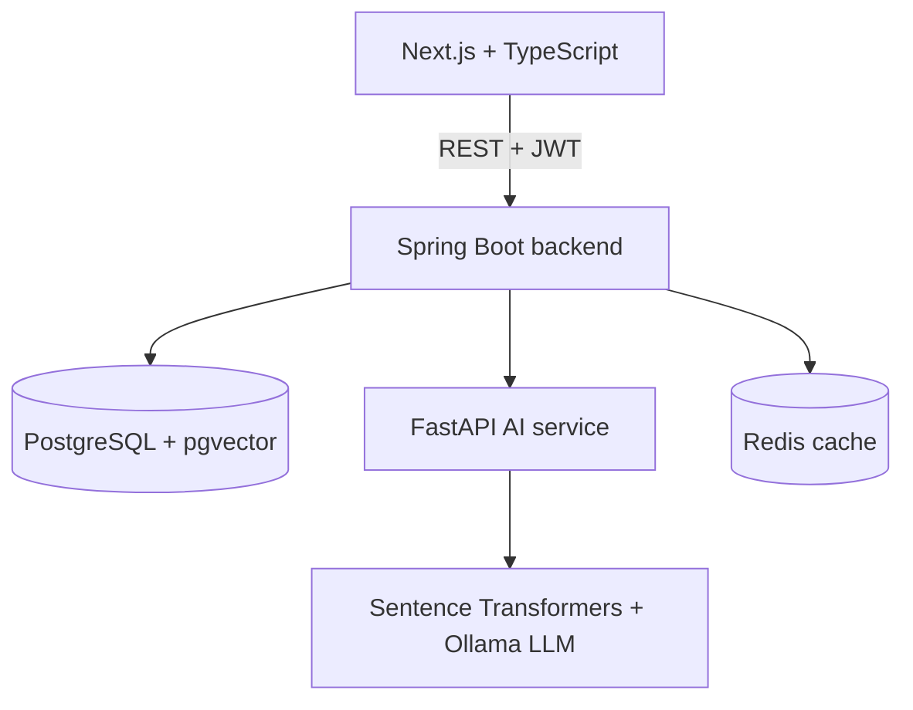

# AI Incident Intelligence Platform

> Turns raw, messy application logs into structured incidents, an observed timeline, similar past incidents, and an **evidence-grounded** root-cause hypothesis with suggested investigation steps.

🚧 **Status: in progress.** Built solo over 70 days. Architecture decisions: [`docs/decisions`](docs/decisions/).

## What it does



The LLM is the last step of a long pipeline. The pipeline is measured against simple baselines (see **Results**, coming in week 10).

## Architecture



**Design rule:** deterministic, testable logic lives in Spring Boot. Anything needing the Python ML ecosystem lives in FastAPI. The AI service never owns data or authorization.

## Tech stack

|Area|Technology|
|-|-|
|Frontend|Next.js, React, TypeScript, Tailwind CSS, TanStack Query|
|Backend|Java, Spring Boot, Spring Security, JWT, Spring Data JPA, Flyway|
|Database|PostgreSQL, pgvector|
|AI service|Python, FastAPI, Pydantic, Sentence Transformers, Ollama|
|Cache|Redis|
|Testing|JUnit, Mockito, Testcontainers, Pytest, Vitest|
|Infra|Docker, Docker Compose, GitHub Actions|

## Quick start

*Coming on Day 62 (full Compose stack). Target: `docker compose up` starts everything.*

## Results

*Coming on Days 65 to 68. Only measured numbers will appear here, each with dataset size, number of scenarios and number of runs. See `eval/REPORT.md` when it exists.*

## Supported log formats

*Filled on Day 28. No claim of universal format support.*

## Known limitations

* There is no universally correct rule for deciding whether events belong to one incident
* Grouping is heuristic and can over-merge or over-split
* Without a baseline, anomaly signals are relative to the uploaded file only
* Semantic similarity does not imply the same root cause
* LLM output is a hypothesis. Recommendations can be wrong
* Verification proves a citation exists and belongs to the incident, not that it supports the claim
* Self-reported LLM confidence is poorly calibrated
* Logs often do not contain enough information. The system then says INSUFFICIENT_EVIDENCE
* Synthetic data does not capture all real-world messiness
* A local model may be weaker than a hosted one
* Parser support is limited to the documented formats

## Repository layout

```
incident-intel/
├── frontend/     # Next.js + TS + Tailwind + TanStack Query
├── backend/      # Spring Boot (Flyway SQL migrations)
├── ai-service/   # FastAPI
├── datagen/      # synthetic log generator + manifests
├── eval/         # evaluation scripts and results
|── docs/         # architecture and design docs, ADRs
├── docker-compose.yml
├── .env.example
└── .github/workflows/
```
## Milestones

|Tag|Day|Done|
|-|-:|:-:|
|`v0.0-foundations`|7|⬜|
|`v0.1-skeleton`|14|⬜|
|`v0.2-auth`|21|⬜|
|`v0.3-upload-parse`|28|⬜|
|`v0.4-thin-ui`|35|⬜|
|`v0.5-datagen-grouping`|42|⬜|
|`v0.6-incidents-embeddings`|49|⬜|
|`v0.7-ai-analysis`|56|⬜|
|`v0.8-full-stack`|63|⬜|
|`v1.0`|70|⬜|

## License

*To be chosen on Day 69.*

